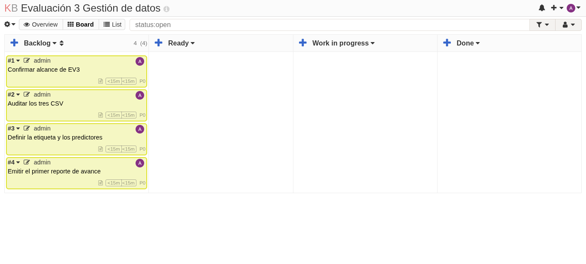
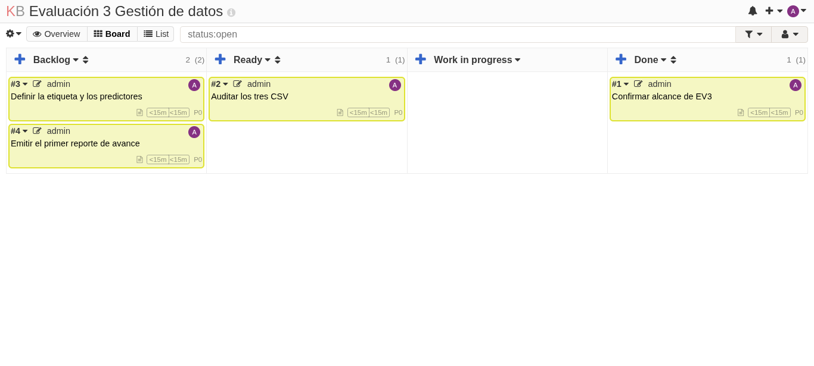
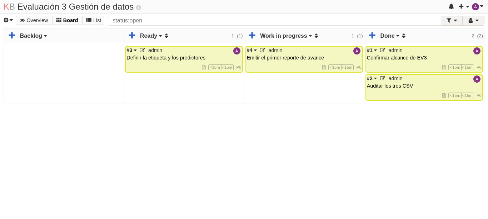
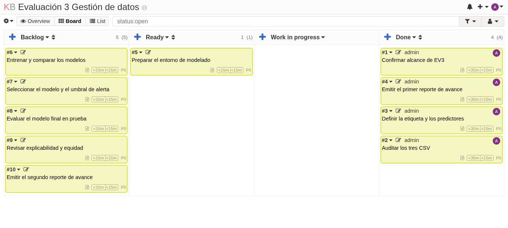
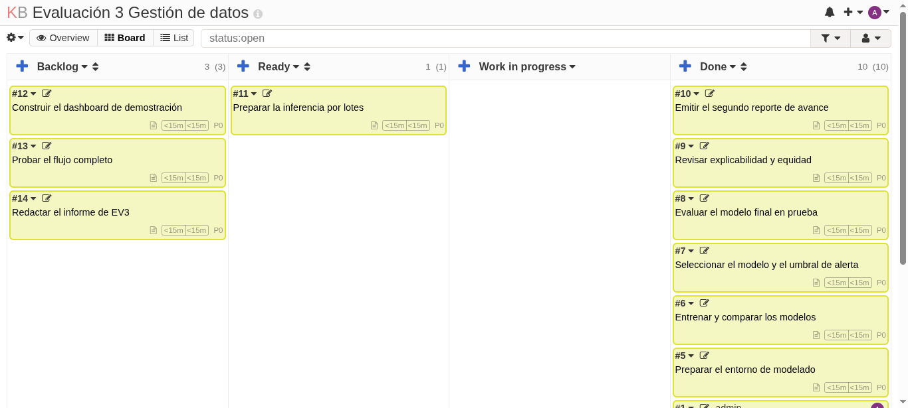
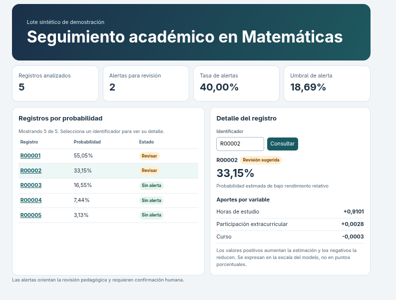

# Bitácora del tablero de la Evaluación 3

## 01 · Configuración inicial del tablero

El equipo abrió el tablero en Kanboard y registró las primeras cuatro tareas de la evaluación. Las cuatro aparecen en **Backlog**. Las columnas **Ready**, **Work in progress** y **Done** aparecen vacías en este primer corte.

| Tarjeta | Tarea | Evidencia esperada |
|---|---|---|
| #1 | Confirmar alcance de EV3 | Entregables de la evaluación y su relación con lo acordado en EV2. |
| #2 | Auditar los tres CSV | Notebook con el diagnóstico de estructura, volumen y calidad de los datos. |
| #3 | Definir la etiqueta y los predictores | Justificación del corte de `TestScore_Math` y de los predictores disponibles antes de la alerta. |
| #4 | Emitir el primer reporte de avance | Registro del trabajo ejecutado, riesgos, desviaciones observadas y decisiones. |

Esta captura deja constancia de las tareas priorizadas al inicio. El siguiente corte registrará qué tarjetas cambiaron de estado y qué evidencias respaldan ese avance.

<!-- Para cada nuevo corte, agregar número de corte, captura, movimientos de tarjetas, evidencias y, si corresponde, desviaciones y acciones correctivas. -->

## 02 · Alcance documentado y comienzo de la auditoría

- **Tarjeta #1.** Se documentó el [alcance de EV3](alcance_ev3.md) y su relación con los entregables de EV2. La evidencia está lista para cerrar la tarjeta.
- **Tarjeta #2.** Se inició el [notebook de auditoría](../Notebooks/01_comprension_y_eda.ipynb), con una lectura por bloques de los archivos de entrenamiento, validación y prueba.

En este corte, la tarjeta **#1** pasó a **Done** y la **#2** pasó a **Ready**. Las tarjetas **#3** y **#4** siguen en **Backlog** y **Work in progress** aparece vacía. El notebook ya registra trabajo técnico posterior a ese estado de la tarjeta #2.

## 03 · Primeros resultados de la auditoría

El notebook procesó los 10.000.000 de registros. Los tres CSV comparten 21 columnas. La lectura no detectó valores faltantes ni huellas de filas completas repetidas dentro de cada conjunto o compartidas entre ellos. Sin un identificador de estudiante, la comprobación se limita a filas completas.

En entrenamiento, el puntaje de Matemáticas tuvo una mediana de 75,00 y un percentil 20 de 66,57. Son referencias descriptivas para discutir la etiqueta. La tarjeta #2 sigue abierta para completar el diccionario, los rangos y la revisión de procedencia y representatividad. La tarjeta #3 queda pendiente.

## 04 · Cierre técnico de la auditoría y primer reporte

Se completó el perfil de las 21 variables con rangos y frecuencias para los tres archivos. El notebook documenta los límites de procedencia, la propuesta de corte y los predictores candidatos. El [primer reporte de avance](reporte_avance_01.md) compara lo planificado con lo ejecutado. Este corte registra evidencias de trabajo y queda pendiente la próxima captura de Kanboard.

## 05 · Auditoría cerrada en Kanboard

La tarjeta **#2** pasó de **Ready** a **Done** y quedó junto a la **#1**. La **#3** pasó de **Backlog** a **Ready** y la **#4** pasó de **Backlog** a **Work in progress**. La captura corresponde al estado del tablero antes de ejecutar la preparación de datos.

## 06 · Etiqueta y preparación verificadas

El [notebook de preparación](../Notebooks/02_preparacion_y_pipeline.ipynb) fijó el corte de la tarjeta #3 en 66,57446853227711, calculado sobre entrenamiento. La clase positiva representa el 20,00 % de entrenamiento y el 20,07 % de validación. El modelo inicial recibirá Grade, StudyHours y Extracurricular. Se validó el esquema de las 999.997 filas de prueba, que quedan reservadas para la evaluación final.

Las tarjetas #3 y #4 ya tienen evidencia para el cierre. La siguiente tarea propuesta es comparar un clasificador base, regresión logística y un modelo de árboles en validación.

## 07 · Backlog de modelado

Las tarjetas #1 a #4 aparecen en **Done**. La #5 está en **Ready**, las #6 a #10 en **Backlog** y **Work in progress** está vacía.

Se acordó conservar los CSV originales. El notebook de preparación genera las matrices y la etiqueta en memoria con la misma regla para cada partición. Se reutilizó un entorno local con scikit-learn después de que el entorno inicial no pudo instalar la dependencia.

## 08 · Modelado, evaluación y segundo reporte

Se ejecutó el [notebook de modelado](../Notebooks/03_modelado_y_validacion.ipynb). Se seleccionó regresión logística en validación y se aplicó el umbral congelado a prueba. El modelo alcanzó un recall de 70,17 % y generó alertas en el 43,70 % de los casos. Se verificaron las explicaciones locales y se calcularon métricas por grupo.

El [segundo reporte](reporte_avance_02.md) registra el ajuste de entorno y las limitaciones para el trabajo pedagógico. Las tarjetas #5 a #10 tienen evidencia de ejecución. Sus movimientos en Kanboard quedan pendientes de registrar en la próxima captura.

## 09 · Cierre del modelado y planificación de la integración

La captura registra diez tarjetas en **Done**. La #11 aparece en **Ready** y las #12 a #14 en **Backlog**. La columna **Work in progress** está vacía.

## 10 · Prototipo integrado y verificación técnica

Se exportó el modelo evaluado y se procesó un lote sintético de cinco registros con dos alertas. El panel respondió correctamente a consultas autenticadas y rechazó las que no incluían credenciales. Se verificó también el rechazo de dos entradas inválidas. Como el entorno no permite abrir un puerto local, las solicitudes HTTP se simularon sobre el controlador y queda pendiente la prueba visual en navegador.

Se preparó el [borrador del informe](../Informe_EV3.md) con los resultados y las diferencias de alcance respecto de EV2. Queda pendiente reflejar la ejecución en Kanboard y guardar la próxima captura del tablero.

## 11 · Revisión visual y rediseño del panel

La captura compartida en la conversación confirmó que el panel original abrió en el navegador con el lote sintético de cinco registros. Se reorganizó el diseño en un resumen, una lista ordenada por probabilidad y una ficha de detalle. Se verificó que el HTML conserva los resultados del lote y marca su origen sintético. Queda pendiente capturar la nueva interfaz en el navegador.

## 12 · Verificación visual y cierre documental

La prueba en navegador confirmó la visualización de cinco registros sintéticos y dos alertas. La ficha seleccionada muestra el registro R00002 con una probabilidad de 33,15 % y sus aportes por variable. La captura respalda el cierre de la tarea #13. El informe final documenta la integración, los resultados y sus limitaciones. La captura 05 sigue siendo el último estado de Kanboard disponible.

## 13 · Carga web y trazabilidad del estudiante

Se agregó una carga de CSV al panel autenticado. Los dos lotes sintéticos usan los mismos códigos internos y producen dos alertas y una alerta respectivamente. La ficha muestra nombre, código y curso. Las pruebas del controlador confirmaron la actualización del panel, el rechazo de solicitudes no autorizadas y la conservación del lote vigente al rechazar identificadores duplicados.
